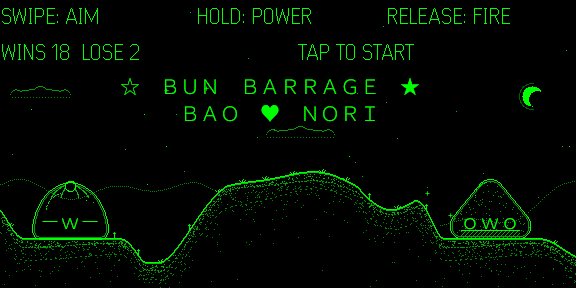
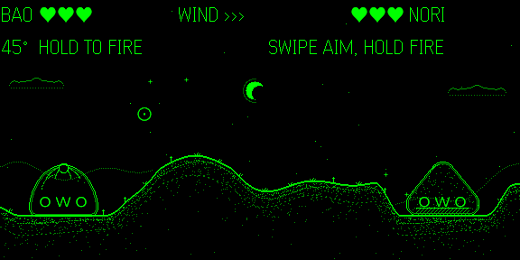
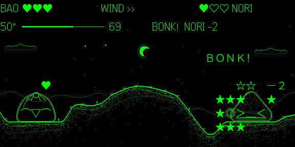
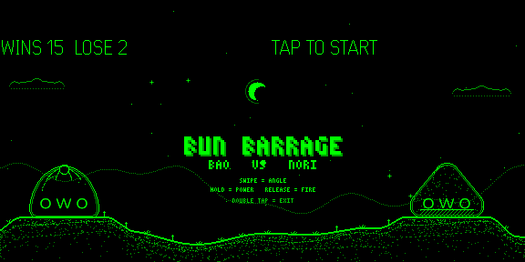

# Bun Barrage

A turn-based lobbing duel for **Even Realities G2** smart glasses. Bao the steamed bun and Nori the rice ball trade shots across moonlit hills. Set your angle and power, read the wind, and knock out the rival's three hearts.






## Play

Play with the **R1 ring**, the **touchpad on the glasses' temple**, or the **on-screen buttons on your phone**, whichever is handy:

| Gesture | Action |
|---|---|
| Swipe up / down | aim: 5° per swipe. A crosshair ⊙ circles your hero and moves on every single step, leaving a brief ・ where it was; at 10° or 80° it blinks to say it can't go further. No trajectory guide: reading the arc and the wind is the game |
| Long press | charge power: the meter climbs 10→100, then falls back if you over-hold |
| Release | fire |
| Double tap | back to title; on the title screen: exit dialog |

- Three hearts each. A direct hit (BONK!) costs 2, a near miss (splash) costs 1, and you can hit yourself.
- Wind changes every turn; the flag shows it. The notch on the power meter marks your last shot.
- Nori's crosshair visibly swings toward its chosen angle before it charges.
- Bao and Nori blink (ｏｗｏ → －ｗ－), strain while charging (≧ｗ≦), recoil (ｏ△ｏ), get bonked (＞﹏＜) and dizzy with stars circling (◎﹏◎), shake it off (－﹏－), sweat at near-misses (ｏ﹏ｏ〃), stick out a tongue when you miss (ｏｐ－), cheer with hearts (⌒▽⌒ / ≧▽≦) and faint (Ｘ﹏Ｘ).

On the phone page you can also play with on-screen buttons: ▲/▼ angle, hold FIRE to charge and release to shoot, TAP to start, BACK. Keyboard: ↑↓ angle, hold Space = long press, Enter = tap, Esc = double tap.

## Develop

```bash
npm install
npm run dev        # Vite on :5173 (0.0.0.0)
npm run qr         # QR code → scan in the Even app to sideload onto the glasses
npm test           # game-logic tests (vitest)
npm run preview    # renders sample frames to preview/*.png
npm run pack       # build + bun-barrage.ehpk
```

### Simulator

The official simulator (`@evenrealities/evenhub-simulator`, tested on 0.9.5) runs the app unchanged:

```bash
npm run dev
npx @evenrealities/evenhub-simulator --automation-port 9898 http://127.0.0.1:5173
./scripts/sim-drive.sh   # scripted turn: taps/swipes + glasses screenshots into sim/
# full scripted match recorded to sim/match.gif (load the app with ?hint):
#   npx @evenrealities/evenhub-simulator --automation-port 9898 "http://127.0.0.1:5173/?hint&latency=110"
#   (latency=110 adds the real glasses' per-send delay, so the simulator's frame rate is realistic)
python3 scripts/sim-play.py
```

On a headless Linux box, wrap it in `xvfb-run -a` and install `libwebkit2gtk-4.1-0`.
Or use [even-dev](https://github.com/BxNxM/even-dev): `APP_PATH=/path/to/bun-barrage ./start-even.sh`.

## How it works

Built around the official Even Hub guidance for real hardware: *image frames cost ~0.5–2 s each over BLE, text updates are much faster, serialise all bridge calls*.

- **The picture is a static line-art stage.** Four 288×144 image tiles hold only what never changes during a match: the starry sky and moon, a faint distant range, crisp hill contours with a speckle texture that fades with depth, and the heroes' bodies as bright outlines with dark insides. No large lit areas, which on the lenses read as a heavy green slab. The sky is identical on every screen, so it is sent once; the hills and bodies are sent once when a match starts. **During a match no image is sent at all.**
- **Everything that moves or reacts is text.** A 28×8 grid in one text container carries the heroes' faces (fine-line kaomoji placed exactly inside their bodies), the aiming crosshair ⊙ (a 20×27 px text cell is too coarse for 5° steps, so a second text layer shifted by half a cell doubles the resolution: a searched table gives each of the 15 angles its own spot on a ring around the hero, and the queue updates the layer that gains the crosshair first so it never blinks out), the flying shell ● and its trail, explosion frames, BONK!, circling dizzy stars ★☆, −2, ♥ and confetti. Every glyph was measured in the simulator to be exactly one cell wide (many common kaomoji parts such as ω, ᴥ, • are narrow or missing in the glasses font and are avoided); each cell is 20 px wide and lines are 27 px apart (the same grid the community pong game uses on real glasses). Heroes stand on fixed, cell-aligned pads so faces always line up.
- **Text for the HUD too.** Hearts, wind, angle, the live power slider (`47°  ━━━━────  55`) and status lines (YOUR TURN!, BONK!, MISS!) are text containers, which update in well under 0.1 s.
- **One serialized bridge queue.** HUD text first, then the effects grid, then image tiles (only at screen changes), then debounced storage. Every call has a timeout.
- **No craters.** Terrain stays intact so the stage never has to be re-sent; shots, splash damage and wind work as before.

Measured in the official simulator with 600 ms added to every image send:

| Input | Visible after |
|---|---|
| Tap | ~0.10 s |
| Swipe (angle) | ~0.1 s (launcher glyph and angle text) |
| Long press (power meter) | ~0.05 s, updating smoothly while held |
| Release (shot) | ~0.07 s |

The title screen already shows the next match's field (its logo and hints are text), so tapping start sends no image: the match is on screen at once (measured in the simulator with 600 ms per image: field complete 0 s after the tap, down from ~2 s). New hills are sent only on the way back to the title. So: 4 image tiles at launch, 2 per return to the title, none when starting or playing. Before v0.5 a match needed about 46.

About 95% of every tile is black. On G2, black means the LED is off, so those areas are see-through on the lenses and each 288×144 tile is only 1–4 KB.

Debug switches for the simulator: `?latency=600` (add per-send delay), `?debug` (log every bridge call), `?hint` (log ideal aim for scripted runs).

## Known issues

- **Exit dialog → "No".** On current Even hosts, image sends can fail until relaunch after the user cancels the exit dialog. EvenChess reports the same. Following their approach, the app leaves the page untouched and, if the image channel is dead, shows a text note asking you to reopen.
- **Stats in the WebView.** Stats are stored with the SDK's `setLocalStorage` (plus browser storage as a fallback).

## Originality

All art, the font, names and code were made for this project. Bun Barrage uses the long-standing public "artillery game" genre mechanics (angle, power, wind). It does not use characters, names, art or sounds from any existing game.

## License

MIT © JintaoHe. See [LICENSE](LICENSE).

## Contributing and security

Contributions go through pull requests; see [CONTRIBUTING.md](CONTRIBUTING.md). Report vulnerabilities privately as described in [SECURITY.md](SECURITY.md).
